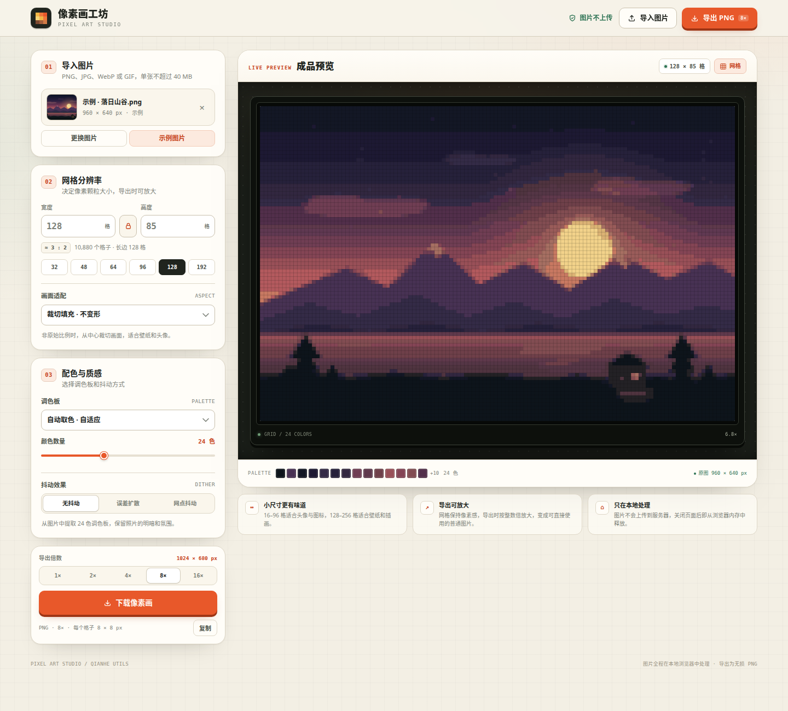
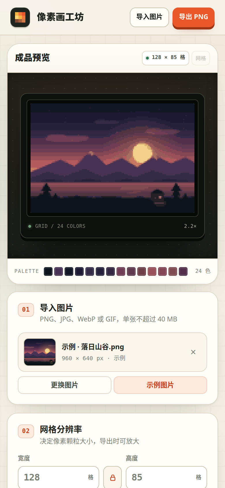

# 像素画工坊

一个零依赖、打开即用的图片转像素画网页工具。导入照片或插画，调好网格分辨率与配色，就能实时预览，并按整数倍放大导出为可正常使用的 PNG。



## 快速开始

直接用浏览器打开 `index.html`（双击即可，无需安装、无需联网）。

1. 点击「导入图片」，或把图片拖入页面，也可以直接按 `Ctrl / ⌘ + V` 粘贴剪贴板中的图片。
2. 在「网格分辨率」中拖动预设或输入宽高。这里的数字是像素格子数，默认锁定原图比例，默认长边 128 格。
3. 在「配色与质感」中选择调色板、颜色数量与抖动方式，右侧会实时显示成品。
4. 在「导出倍数」中选择放大倍率（默认 8×），再点击「下载像素画」。例如 128 × 85 格、8× 会导出 1024 × 680 px 的 PNG。

每个格子会变成 N × N 个图像像素，边缘保持锐利，可直接作为普通图片使用。

没有现成图片时，可以点击「加载示例」体验完整流程。



## 功能

- **图片导入**：支持 PNG、JPG、WebP、GIF（截取当前帧），单张不超过 40 MB；支持拖放、文件选择和剪贴板粘贴。
- **自定义网格分辨率**：宽高各自可在 4–512 格之间调整；提供 32 / 48 / 64 / 96 / 128 / 192 长边预设。
- **比例锁定**：默认保持原图比例；解锁后可以自由设置尺寸。重新锁定会以当前宽高比为准。
- **画面适配**：可选择「裁切填充」（居中裁切、不变形）或「拉伸铺满」（保留全图、允许变形）。
- **自适应调色板**：使用中位切分算法从画面中提取 2–64 色，尽量保留明暗与氛围。
- **固定调色板**：内置 Game Boy（4 色）、PICO-8（16 色）、Sweetie 16（16 色）、灰度 8 级、黑白 2 色。
- **保留原色**：只降采样、不做颜色量化，适合颜色本来就很干净的素材。
- **抖动效果**：无抖动、Floyd–Steinberg 误差扩散、4×4 Bayer 网点抖动，让渐变或有限色板更有层次。
- **实时预览**：像素级画布、棋盘格透明背景、缩放倍率显示、可开关的像素网格，以及成品调色板色卡。
- **放大导出**：支持 1× / 2× / 4× / 8× / 16× 整数倍放大，默认 8×；每个格子变成 N × N 像素，单边最大 4096 px。超出上限的倍率会自动禁用并回落到可用倍率。
- **复制**：以当前导出倍率把图片复制到剪贴板（需要浏览器剪贴板权限）。
- **本地处理**：图片不会上传到任何服务器。
- **快捷键**：`Ctrl / ⌘ + O` 导入，`Ctrl / ⌘ + S` 导出，`Ctrl / ⌘ + V` 粘贴。
- **响应式布局**：桌面端左侧设置、右侧预览；移动端预览置顶，可正常操作完整流程。

## 处理流程

1. 将原图按目标网格尺寸绘制到画布。使用浏览器的高质量降采样，把细节平均到每个格子里。
2. 根据所选方案建立调色板。自适应模式会在透明像素之外统计颜色，并用中位切分压缩到指定色数。
3. 把每个格子映射到最近的调色板颜色。开启抖动时，误差扩散或 Bayer 阈值会在映射前扰动颜色。
4. 输出 RGBA 像素数据，保留原图透明度，得到网格分辨率的成品画布。
5. 导出时用最近邻算法按所选整数倍放大，每个格子对应一个 N × N 的纯色像素块。

## 数据与限制

- 所有处理均在浏览器本地完成，不会发起网络请求。
- 网格宽高各自最大 512 格。
- 导出 PNG 的真实尺寸 = 网格宽高 × 导出倍数，单边最大 4096 px；超出时对应倍率不可用。
- 默认导出倍率为 8×，因此 128 × 85 格会导出为 1024 × 680 px。
- 选择非原图比例时，「裁切填充」只支持居中裁切，暂不支持手动调整裁切位置。
- GIF 只截取渲染时显示的当前帧，不保留动画。
- 图片会保留透明度；降采样后的边缘可能带有半透明像素。
- 复制到剪贴板依赖浏览器权限；在 `file://` 下若不可用，请直接下载。
- 需要较新的 Chrome / Edge / Firefox / Safari。

## 测试

```bash
node --test pixel-art/tests/engine.test.js
```

测试直接从 `index.html` 中提取 `id="pixel-engine"` 的纯 JavaScript 引擎，覆盖颜色转换、中位切分调色板、固定调色板映射、透明度处理、误差扩散与网点抖动的确定性和颜色约束。

## 实现

单文件 `index.html`，原生 HTML/CSS/JavaScript，无第三方依赖。

- `id="pixel-engine"`：与 DOM 无关的图像处理引擎，负责自适应调色板、最近色映射、抖动和颜色统计。
- `id="pixel-app"`：界面、图片解码、Canvas 降采样、实时预览、整数倍最近邻放大、导出与交互逻辑。
