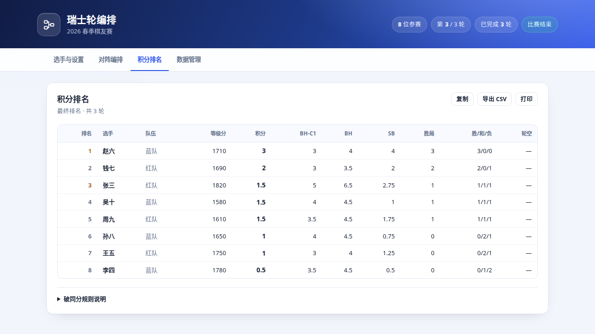

# 瑞士轮编排工具

一个零依赖、打开即用的瑞士轮（Swiss System）赛事编排网页工具，适合棋类、桌游等小型比赛。

## 界面预览




## 快速开始

直接用浏览器打开 `index.html`（双击即可，无需安装、无需联网）。

1. 在「选手与设置」填写赛事名称、总轮数，添加选手。支持批量粘贴，格式为 `姓名,等级分,队伍`，等级分和队伍可以省略。
2. 点击「开始比赛」，生成第 1 轮对阵。
3. 在「对阵编排」中点击「白胜 / 和棋 / 黑胜」录入结果；再次点击已选结果可以清除。
4. 本轮全部录入后，点击「生成下一轮」。
5. 在「积分排名」查看实时排名，可复制、打印或导出 CSV。

数据会自动保存在浏览器 localStorage 中。建议定期在「数据管理」里导出 JSON 备份。

## 功能

- 瑞士轮编排：按积分分组，优先同分对决，禁止重复对阵，兼顾先后手平衡。
- 首轮支持按等级分折叠配对（默认）或随机配对。
- 奇数选手自动轮空，优先安排给「尚未轮空且积分最低」的选手。
- 同队回避（可选）：有队伍信息时尽量避免同队相遇。
- 无法避免重复对阵时给出醒目的提示，不会静默产生错误编排。
- 破同分：对手分（去最低）、对手分、中间分、索恩伯恩-伯格、直胜、胜局数、等级分。
- 破同分顺序可调整、可增删，排名支持并列名次。
- 选手退赛、历史轮次查看、撤销本轮、重新编排本轮。
- 导入/导出 JSON 备份；导出积分榜和对阵表 CSV（带 UTF-8 BOM，Excel 可直接打开）。
- 打印积分榜/对阵表，复制对阵文本。
- 响应式布局，手机浏览器也可使用。

## 编排规则

- **首轮**：按等级分从高到低排序，上半区对下半区（1 对 n/2+1，依此类推）；勾选「首轮随机配对」后先随机洗牌。开启同队回避后，会在上下半区之间交换对手以减少同队对阵。
- **后续轮**：按「积分 → 破同分顺序 → 等级分」排序，以同分组配对为主。搜索时优先选择积分接近的对手，禁止重复对阵，并尽量平衡黑白。
- **轮空**：参赛人数为奇数时，从「尚未轮空且积分最低」的选手中选一人轮空。轮空得分可在设置中选择 1 / 0.5 / 0 分。
- **重复对阵**：如果轮数超过可用的不重复对阵组合，程序会在保证结构合法的前提下接受重复对阵，并在本轮顶部提示具体局数。

编排使用带分支限界的搜索，在「积分差尽可能小」的前提下综合先后手和同队回避，适合几十人规模的比赛。

## 计分与破同分

- 胜 1 分、和 0.5 分、负 0 分；轮空按设置计分。
- **对手分（BH）**：所有对手最终积分之和，轮空不计入对手分。
- **对手分（去最低，BH-C1）**：对手分减去最低的一个对手分；对手少于 2 人时不做扣减。
- **中间分（Median）**：对手分去掉最高和最低；对手少于 3 人时不做扣减。
- **索恩伯恩-伯格（SB）**：胜得对手全分，和得对手半分，负得 0 分。
- **直胜（DE）**：与最终积分相同的选手之间取得的分数之和。
- **胜局数**：获胜局数，轮空不计为胜局。
- **等级分**：登记的等级分，高者优先。

名次先比较积分，再按设置的破同分顺序依次比较；所有比较项都相同则并列名次。等级分默认作为最后的破同分项，但在积分榜中只显示一次。

## 数据与限制

- 所有数据保存在浏览器 localStorage（键名 `qianhe-swiss-system-v1`），不会上传到任何服务器。
- 换浏览器、清理站点数据或使用无痕模式会导致数据丢失，请使用 JSON 备份。
- 这是单机工具，不支持多人同时编辑。
- 不支持手动调整单台对阵；如需重排，可在录入结果前点击「重新编排」。
- 浏览器需支持现代 JavaScript（较新版本的 Chrome / Edge / Firefox / Safari）。

## 测试

```bash
node --test swiss-system/tests/engine.test.js
```

测试会从 `index.html` 中提取编排引擎，覆盖首轮折叠、随机首轮、轮空轮换、重复对阵、计分、对手分/SB、排名并列、退赛、颜色平衡和导入数据校验等。

## 实现

单文件 `index.html`，原生 HTML/CSS/JavaScript，无第三方依赖。编排引擎位于 `id="swiss-engine"` 的脚本中，界面逻辑位于 `id="swiss-app"` 的脚本中。
